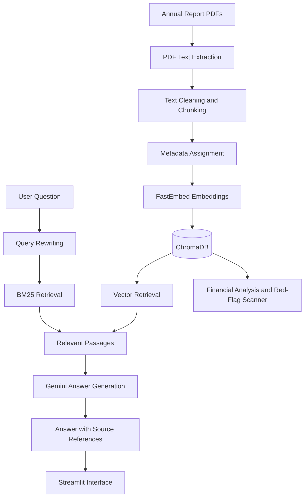

# Earnings & Annual Report Analyst

A Retrieval-Augmented Generation (RAG) application for analysing company annual reports and financial disclosures. Ask questions about revenue, profitability, management explanations and business risks, with answers grounded in retrieved report passages and source-page references.

The project currently includes Infosys FY2024 and FY2025 annual reports.

## Features

- PDF text extraction and chunking.
- Local semantic embeddings using FastEmbed.
- Persistent vector storage with ChromaDB.
- Metadata filtering by company, financial year and document type.
- BM25 keyword retrieval and query rewriting.
- Gemini-powered answers with source references.
- Labelled answers separating reported facts, management claims and interpretation.
- Financial metric calculations using Python.
- Evidence-based red-flag screening across seven disclosure themes.
- Automated tests using pytest.

## Architecture



## Technology Stack

| Component | Technology |
|---|---|
| Language | Python |
| PDF extraction | PyMuPDF |
| Embeddings | FastEmbed |
| Embedding model | BAAI/bge-small-en-v1.5 |
| Vector database | ChromaDB |
| Keyword retrieval | BM25 |
| LLM | Google Gemini |
| Interface | Streamlit |
| Testing | Pytest |

## Setup on Windows

### 1. Clone the repository

```powershell
git clone https://github.com/YOUR_USERNAME/earnings-analyst.git
cd earnings-analyst
```

### 2. Create and activate a virtual environment

```powershell
python -m venv .venv
.\.venv\Scripts\Activate.ps1
```

### 3. Install dependencies

```powershell
python -m pip install --upgrade pip
pip install -r requirements.txt
```

### 4. Configure environment variables

Create a `.env` file in the project root by copying `.env.example`.

```powershell
Copy-Item .env.example .env
```

Add your Gemini API key and configured model ID:

```env
GEMINI_API_KEY=your_api_key
GEMINI_MODEL=your_model_id
```

Get an API key from [Google AI Studio](https://aistudio.google.com/).

Never commit your `.env` file or expose your API key.

## How to Add Documents

Place annual report PDFs inside:

```text
data/raw/
```

Use the following naming convention:

```text
COMPANY_FY2025_annual-report.pdf
```

For example:

```text
INFOSYS_FY2025_annual-report.pdf
```

Run ingestion:

```powershell
python -m scripts.ingest "data\raw\INFOSYS_FY2025_annual-report.pdf"
```

To ingest all PDFs in the folder:

```powershell
python -m scripts.ingest (Get-ChildItem data\raw\*.pdf).FullName
```

The documents are extracted, chunked, embedded and stored in the persistent ChromaDB collection.

## Run the Application

```powershell
streamlit run app.py
```

Select the company, financial year and document type, then enter a question about the available reports.

The application supports both standard answers and labelled answers that distinguish reported facts, management claims and interpretation.

## Evaluation

The retrieval pipeline was evaluated using answerable and unanswerable questions.

### Development evaluation

| Retrieval approach | Answerable questions retrieved |
|---|---:|
| Vector baseline | 18/28 (64.3%) |
| BM25 | 23/28 (82.1%) |
| Rewritten BM25 | 27/28 (96.4%) |
| Hybrid retrieval | 26/28 (92.9%) |

Additional development results:
- Final retrieval hit rate: 27/28 (96.4%).
- Correct refusals for unanswerable questions: 5/5.
- Manually assessed answer correctness: 31/33 (93.9%), provisional.

### Held-out evaluation

The held-out dataset initially showed weaker performance than the development dataset. Rewritten BM25 retrieval reached 14/20 (70%) in one recorded run, with later debugging results reaching 15/20 (75%).

**Evaluation note:** The held-out questions were subsequently used during debugging, so these results should not be presented as a pristine final benchmark.

## Financial Analysis

The project extracts financial figures and uses Python to calculate metrics rather than relying on the LLM for arithmetic.

Example: Infosys FY2024 versus FY2025.

| Metric | FY2024 | FY2025 |
|---|---:|---:|
| Revenue (₹ crore) | 153,670 | 162,990 |
| Operating profit (₹ crore) | 31,747 | 30,880 |
| Net profit (₹ crore) | 26,248 | 26,713 |
| Operating margin | 20.7% | 18.9% |
| Net margin | 17.1% | 16.4% |

These figures were checked against the corresponding annual report pages.

## Red-Flag Screening

The scanner searches retrieved report passages for seven disclosure themes:

1. Auditor remarks
2. Related-party transactions
3. Contingent liabilities and litigation
4. Liquidity and debt
5. Exceptional items
6. Accounting changes
7. Leadership changes

The output provides supporting evidence, management explanations, quotations, source references and an assessment for further review.

These are screening observations, not conclusions of wrongdoing.

## Design Decisions

- **Local embeddings:** FastEmbed with BAAI/bge-small-en-v1.5 avoids dependence on an external embedding API and its usage quotas.
- **Persistent vector storage:** ChromaDB retains document embeddings and metadata for reuse.
- **Custom RAG pipeline:** The retrieval and generation stages are implemented explicitly rather than hidden behind LangChain abstractions.
- **Hybrid retrieval experiments:** Vector search, BM25 and query rewriting were evaluated to understand their impact on retrieval.
- **Python for financial calculations:** The LLM proposes or identifies financial figures; verified values are used in Python calculations with unit checks.
- **Evidence-based answers:** The application supports refusing questions when the available documents do not contain sufficient evidence.

## Limitations

- PDF table extraction may not preserve complex financial tables perfectly.
- Scanned PDFs may require OCR before they can be analysed.
- PDF viewer page numbers may differ from printed report page numbers.
- Retrieval quality depends on document extraction, chunking and metadata.
- Gemini API usage may be affected by free-tier quotas, rate limits and model availability.
- Earnings-call transcripts are not currently included in the demonstrated Infosys dataset.
- Red-flag screening identifies passages for human review; it does not establish wrongdoing.
- Results depend on the documents ingested and should be independently verified.

## Disclaimer

This project is intended for educational and research purposes only. It does not provide investment advice, financial recommendations or audited conclusions. Always verify extracted figures and interpretations against the original company disclosures.

## Running Tests

Run the automated tests from the project root:

```powershell
python -m pytest -q
```

The current test suite covers chunking, filename parsing, financial calculations and unit validation.
